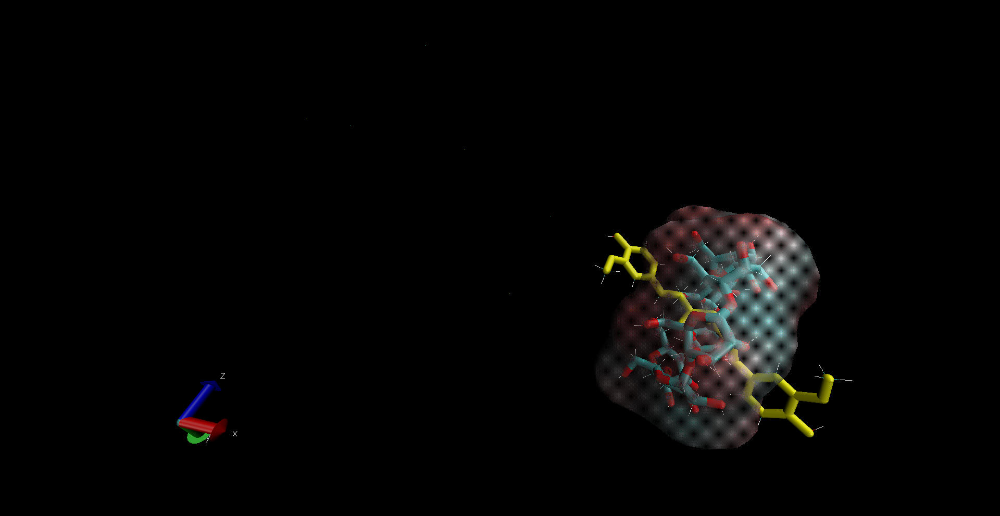

# CUR + β-CD — Visualization

Rendered visualization of the **curcumin + β-cyclodextrin (CUR + β-CD)**
inclusion complex, generated in VMD from the PBC-corrected 100 ns
production MD trajectory.

---

## Rendered image

The image shows curcumin (yellow) encapsulated inside the β-cyclodextrin
cavity (licorice + transparent surface), with hydrogen bonds between host
and guest shown as cyan dashed lines.

---

## Render details

| Parameter | Value |
|-----------|-------|
| Tool | VMD 2.0.0a6 |
| Input | `results/md_simulations_100ns/cur_bcd/step5_production_fixed.xtc` |
| Renderer | Snapshot (VMD) |
| Output | `cur_bcd_complex.png` |

---

## Representations used

| # | Style | Material | Color | Selection | Purpose |
|---|-------|----------|-------|-----------|---------|
| 1 | Licorice | Opaque | Name | `resname BCD and not hydrogen` | β-CD host (sticks) |
| 2 | Licorice | Opaque | ColorID 4 | `resname CUR and not hydrogen` | Curcumin guest (yellow sticks) |
| 3 | Lines | Opaque | Name | `all not water` | Full system outline |
| 4 | HBonds | Opaque | ColorID 8 | `all not water` | Host–guest hydrogen bonds |
| 5 | QuickSurf | Transparent | Name | `resname BCD and not water` | β-CD surface (semi-transparent) |

---

